<b>Gotta Catch</b>

<b>——————————————————————————————</b>

Gotta Catch is a typeface family created by the students of the <a href="http://dnmade-prevert.fr/">DNMADE ‘Graphisme augmenté’</a> (Lycée Jacques Prévert, Boulogne-Billancourt, Fr), during a type design initiation workshop given by <a href="http://lucasdescroix.fr">Lucas Descroix</a> in March 2021.

Each student was asked to create a display typeface based on a <a href="https://bulbapedia.bulbagarden.net/wiki/Type">type of Pokémon</a>. In order to get an interesting conceptual distance they first gathered words and images, then explored abstract rhythms by hand. The idea was to delve into influences and inspirations outside the field of typography, in order to create new and surprising letterforms. The students were encourage to translate their initial keyword more on a structural than illustrative level. After a couple of days of vector drawing and initiation to the type-design software and the notion of components, the students designed typographic compositions to serve as specimen and display their typeface in the light of its initial starting point. Those graphics are gathered on a <a href="http://lucasdescroix.fr/teaching/gottacatch">dedicated mini-site</a>.

The typefaces presented here are available to <a href="https://gitlab.com/bonjour-monde/fonderie/gotta-catch-typeface/-/tree/master/fonts">download</a>, under <a href="https://creativecommons.org/licenses/by-nd/4.0/legalcode">CC BY-ND 4.0 license</a>. This means you can copy, share and use them in any medium or format for any purpose, even commercially. However, you must give appropriate credit and are not allowed to redistribute any modification.

Note that most typefaces only offer uppercase Latin letters, some have numbers and very basic punctuation. They are distributed ‘as is’, with no guaranty whatsoever. Feel free to get in touch with <a href="http://lucasdescroix.fr">Lucas Descroix</a> if you have any inquiry regarding this project.

<b>——————————————————————————————</b>

With Élodie Perez, Jessy Moreira, Emma Grosu, Julia Rodriguez, Tonya Palcy, Erwan Batnini, Julia Koussa, Léo Gobin, Enora Pichavant, Martin Gouriou, Laura François and Sarah Marouzé. Thanks to professors Romuald Roudier Theron and Éloïse Cariou.

<b>——————————————————————————————</b>

→ <a href="http://lucasdescroix.fr/teaching/gottacatch">Results website</a> 
→ <a href="https://gitlab.com/lucasdescroix/gotta-catch-workshop">Workshop repo</a>

<b>——————————————————————————————</b>

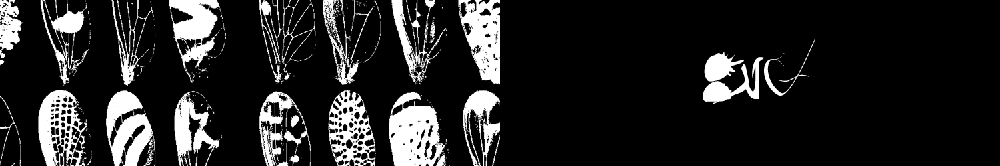
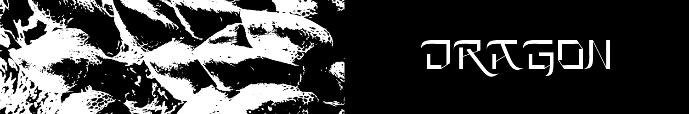
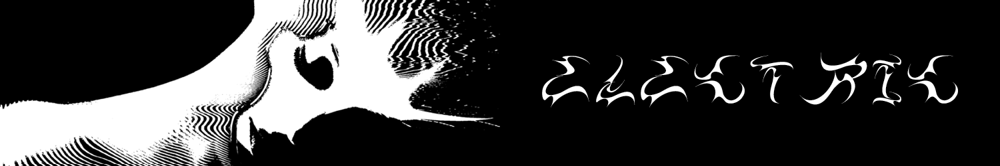
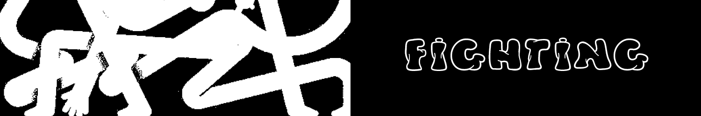
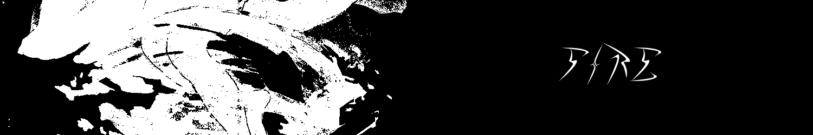
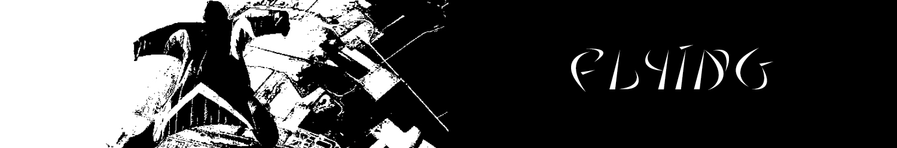
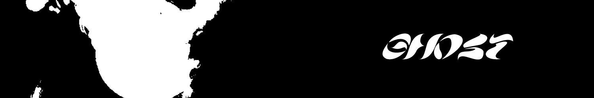
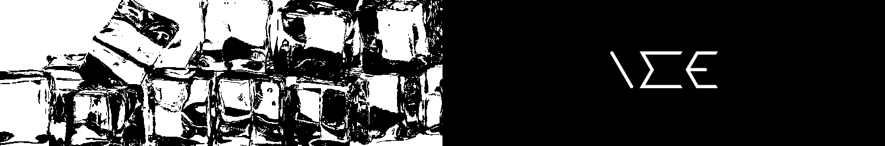

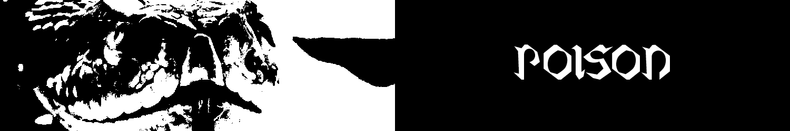
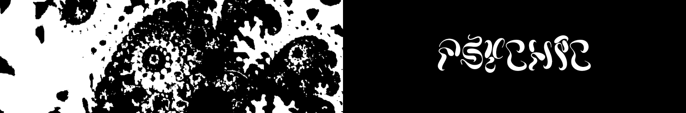
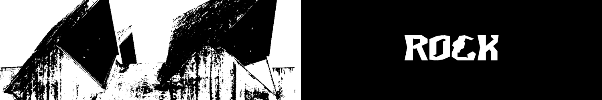
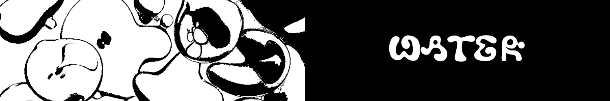
